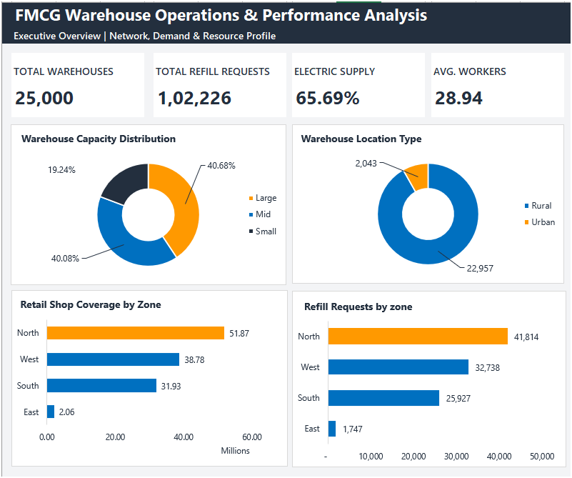
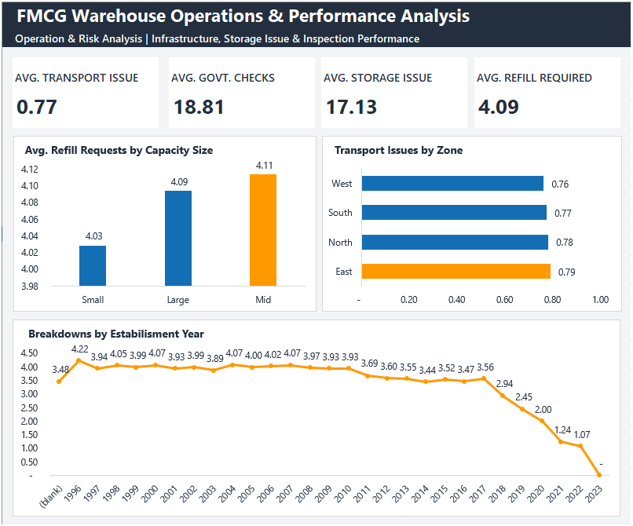

# FMCG Warehouse Operations & Performance Analysis

## Dashboard Preview

## Project Overview

This project focuses on analyzing Amazon's warehouse operations to identify operational patterns, evaluate warehouse performance, and highlight areas for improvement across its distribution network.

Using Microsoft Excel, the project examines **25,000 warehouse records** to understand warehouse capacity, geographical distribution, retail shop coverage, refill requests, storage issues, transportation issues, workforce patterns, government inspections, competitor presence, and warehouse breakdowns.

The analysis uses PivotTables, descriptive statistics, correlation analysis, and trend analysis to transform warehouse data into actionable business insights and recommendations.

## Business Problem

Amazon operates an extensive warehouse network and relies on efficient inventory replenishment, reliable transportation, adequate storage infrastructure, and effective warehouse maintenance.

Operational inefficiencies may contribute to stockouts, delivery delays, and increased operating costs. The objective of this project is to analyze available warehouse data, identify patterns that warrant further investigation, and recommend evidence-based actions to support better operational planning.

## Project Objectives

- Analyze warehouse distribution by capacity size and location type.
- Evaluate retail shop coverage and refill demand across geographical zones.
- Identify warehouse groups with higher reported storage and transportation issues.
- Compare average refill requests across warehouse capacity categories.
- Analyze workforce distribution across rural and urban warehouses.
- Examine government inspection activity and warehouse-level operational indicators.
- Investigate the relationship between competitor presence and refill requirements.
- Explore warehouse breakdown patterns by establishment year.
- Develop an Excel dashboard to communicate key performance indicators, comparisons, and operational findings.
- Recommend practical follow-up actions based on the available evidence.

## Dataset Overview

| Attribute           | Details                                                                                                                                   |
| ------------------- | ----------------------------------------------------------------------------------------------------------------------------------------- |
| Dataset size        | 25,000 warehouse records                                                                                                                  |
| Data source         | [FMCG Supply Chain Optimization Dataset — Kaggle](https://www.kaggle.com/datasets/suraj9727/supply-chain-optimization-for-a-fmcg-company) |
| Analysis tool       | Microsoft Excel                                                                                                                           |
| Analysis techniques | PivotTables, aggregation, descriptive statistics, correlation and trend analysis                                                          |
| Reporting method    | Excel dashboard and business insights                                                                                                     |

### Key Dataset Fields

| Field                          | Description                                              |
| ------------------------------ | -------------------------------------------------------- |
| `Ware_house_ID`                | Unique warehouse identifier                              |
| `Location_type`                | Rural or urban location                                  |
| `WH_capacity_size`             | Small, Mid, or Large warehouse                           |
| `zone`                         | Geographical zone                                        |
| `WH_regional_zone`             | Regional zone identifier                                 |
| `num_refill_req_l3m`           | Refill requests during the last 3 months                 |
| `transport_issue_l1y`          | Transportation issues during the last year               |
| `Competitor_in_mkt`            | Number of competitors in the market                      |
| `retail_shop_num`              | Number of retail shops served                            |
| `electric_supply`              | Electric supply availability                             |
| `dist_from_hub`                | Distance from the central distribution hub in kilometres |
| `workers_num`                  | Number of warehouse workers                              |
| `wh_est_year`                  | Warehouse establishment year                             |
| `storage_issue_reported_l3m`   | Storage issues reported during the last 3 months         |
| `temp_reg_mach`                | Availability of temperature regulation machinery         |
| `approved_wh_govt_certificate` | Government certification category                        |
| `wh_breakdown_l3m`             | Warehouse breakdowns during the last 3 months            |
| `govt_check_l3m`               | Government checks during the last 3 months               |
| `product_wg_ton`               | Weight of products stored, in tons                       |

## Tools & Techniques

### Microsoft Excel

- Data summarization and analysis using PivotTables
- PivotCharts and chart-based comparisons
- Sorting, filtering, and grouping
- Percentage, average, and total calculations
- Conditional formatting and heatmaps
- Correlation analysis
- Trend analysis by establishment year
- KPI reporting and dashboard design

## Dashboard Features

The Excel dashboard is organized into two pages to present network performance and operational analysis.

### Page 1: Executive Overview

- **Warehouse Capacity Distribution:** Compares Large, Mid, and Small warehouses.
- **Warehouse Location Type:** Examines the distribution of rural and urban warehouses.
- **Retail Shop Coverage by Zone:** Compares retail shop coverage across geographical zones.
- **Refill Requests by Zone:** Highlights differences in replenishment requirements across zones.
- **KPI Cards:** Summarize total warehouses, total refill requests, electric supply availability, and average workers per warehouse.

### Page 2: Operations & Risk Analysis

- **Transport Issues by Zone:** Compares average transportation issues across geographical zones.
- **Breakdowns by Establishment Year:** Examines average breakdown patterns across warehouse establishment years.
- **Average Refill by Capacity:** Compares average refill requirements across Large, Mid, and Small warehouses.

## Key Insights

### 1. Warehouse Capacity Distribution

Large warehouses represent **40.68%** of the network, while Mid warehouses account for **40.08%**. Together, they represent **80.76%** of all warehouses.

**Business implication:** Large and Mid warehouses represent the majority of the network and should be considered when reviewing capacity planning and replenishment requirements.

### 2. Rural and Urban Warehouse Distribution

Rural warehouses account for **91.83%** of the network, compared with **8.17%** for urban warehouses.

**Business implication:** Distribution and operational planning should account for the network's strong rural presence and the logistics requirements of serving these locations.

### 3. Retail Shop Coverage by Zone

North has the highest retail shop coverage at **51,869,267**, followed by West at **38,779,469**, South at **31,932,776**, and East at **2,061,277**.

North and West together account for approximately **73.16%** of total recorded retail shop coverage.

**Business implication:** North and West are important areas to consider when reviewing distribution capacity, inventory allocation, and replenishment planning.

### 4. Refill Requests by Zone

North records the highest total refill requests at **41,814**, followed by West at **32,738**, South at **25,927**, and East at **1,747**.

**Business implication:** North has the highest recorded refill demand. Replenishment schedules and inventory planning should reflect the differences in demand across zones.

### 5. Workforce and Storage Issues

The correlation between the number of workers and reported storage issues is approximately **-0.009**, indicating a negligible linear relationship.

**Business implication:** Workforce size alone does not meaningfully explain variation in storage issue reports. Storage conditions, processes, equipment, and reporting practices may warrant further investigation.

### 6. Distance from Hub and Transportation Issues

The correlation between distance from the central distribution hub and reported transportation issues is approximately **0.014**, indicating a negligible linear relationship.

**Business implication:** Distance alone does not explain the observed variation in transportation issues. Route conditions, logistics processes, and infrastructure may need additional investigation.

### 7. Competitor Presence and Refill Requirements

Warehouses with two competitors record the highest total refill requests at **35,432**. This group also contains the largest number of warehouses among the analyzed competitor categories.

**Business implication:** Total refill demand should be interpreted alongside warehouse counts and average refill requirements. The observed totals do not establish that competitor presence causes higher demand.

### 8. Warehouse Breakdowns by Establishment Year

The analysis shows a general decline in average breakdowns among more recently established warehouses. However, **11,881 records have missing establishment years**, and the 2023 group contains only 142 warehouses.

**Business implication:** The trend should be interpreted cautiously because missing establishment-year data and small recent-year groups may affect the comparison. Data completeness should be improved before drawing firm conclusions about warehouse age and breakdown performance.

## Recommendations

1. **Improve replenishment planning:** Review refill demand across North, West, and South to support appropriate inventory allocation and replenishment scheduling.
2. **Align resources with warehouse distribution:** Consider warehouse capacity and rural/urban distribution when planning operational support.
3. **Investigate storage issues:** Use the zone-by-regional-zone heatmap to identify warehouse groups that warrant further review of storage conditions and processes.
4. **Review transportation performance:** Investigate route conditions and logistics processes rather than relying on distance alone to explain transportation issues.
5. **Evaluate demand using multiple metrics:** Compare total refill requests, average refill requests, and warehouse counts when examining competitor presence and warehouse capacity.
6. **Review inspection and certification records:** Use warehouse-level inspection information to identify facilities requiring additional operational or compliance review.
7. **Improve data quality:** Address missing establishment years and validate small sample groups before making maintenance decisions based on breakdown trends.
8. **Monitor operational performance:** Refresh PivotTables and dashboard summaries as new data becomes available, and validate findings with warehouse managers and operations teams.

## Author

**Priyam Jain**
